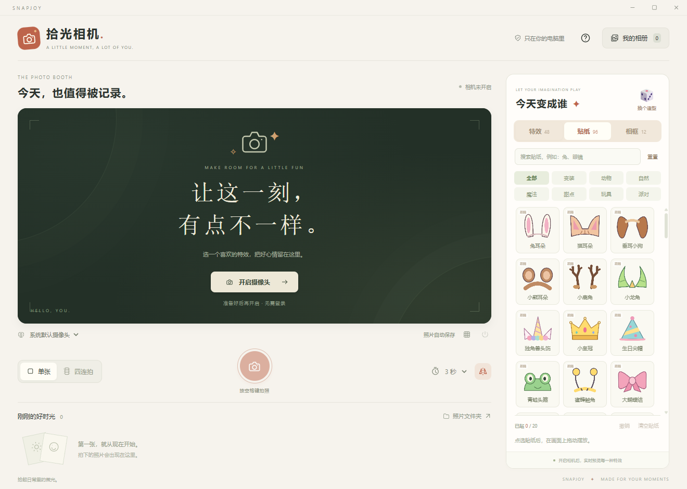

# SnapJoy · 拾光相机

一个适用于 Windows 64 位电脑的本地拍照软件，参考 Photo Booth 的实时特效与拍照体验，采用独立设计的中文界面。

当前版本 **1.1.1**。SnapJoy 表达“拍下快乐”，提供实时特效、趣味贴纸和主题相框，适合自己拍照、亲子互动和朋友聚会。

项目仓库：[ShellLayer/snapjoy](https://github.com/ShellLayer/snapjoy)。仓库包含源码、锁定的依赖版本、本地人脸定位模型和验证资料。版本变化见 [CHANGELOG.md](CHANGELOG.md)。



## 打开与拍照

已打包的本地版本：先关闭旧版窗口，双击项目文件夹内的 **拾光相机** 快捷方式，或 `release/1.1.1/SnapJoy-1.1.1-Windows.exe`。无需安装 Node.js 或其他开发工具。单文件版首次打开需等待程序解压。

也可以打开 `release/1.1.1/win-unpacked/拾光相机.exe`，启动更快；这个版本需要保留同文件夹中的全部文件。本地旧版发布文件保留供回退，新版沿用原来的相册和拍照设置。

GitHub 仓库提供源码，安装包、电脑快捷方式和测试临时文件不加入版本控制。从仓库下载后，请按下文“开发”步骤运行或打包。

1. 点击「开启摄像头」。可使用电脑内置摄像头或 USB 摄像头。
2. 在右侧「特效 / 贴纸 / 相框」里搭配造型，也可以点骰子随机搭配。
3. 选择单张或四连拍，设置即拍、3 秒、5 秒或 10 秒倒计时。
4. 点击圆形拍照按钮，或按空格键拍照。拍摄过程中按 Esc 可以取消。
5. 点击底部缩略图或「我的相册」查看照片，支持另存为和移到回收站。

原图自动保存到 Windows 的 **图片 / 拾光相机** 文件夹。若「图片」目录已被 Windows 重定向，会使用系统实际指定的位置。在软件内点击「照片文件夹」可直接找到。

## 功能

- **48 种效果（含原片）**：保留原有 18 种，新增彩虹糖、棉花糖、海底世界、夜光精灵、彩虹轮廓、水彩绘本、蜡笔涂鸦、波普四格、漫画网点、剪纸、复古掌机、水波、分身、大头娃娃等。分为氛围、搞怪和绘画，可搜索名称。
- **96 款贴纸**：24 款原创变装贴纸，包括兔耳朵、猫耳朵、狗耳朵、鹿角、皇冠、独角兽头饰、青蛙头箍、眼镜、胡须、猪鼻子和太空头盔；另有 72 款动物、自然、魔法、甜点、玩具和派对装饰，使用 Windows 自带彩色表情字体。
- **12 款相框**：拍立得、彩虹乐园、星星梦境、生日快乐、糖果屋、森林探险、海底派对、太空旅行、花花世界、漫画封面、像素冒险、冬日童话。
- 特效、贴纸与相框可以组合；单张与四连拍都会把造型保存进 PNG。
- 右侧缩略图使用实时摄像头画面；相机未开启时显示内置插画，供预览滤镜风格。
- 镜像同时影响取景和保存结果；构图网格只用于取景，不会印在照片里。
- 四连拍依次拍下四张照片，合成为有日期页脚的纵向照片条。选择「即拍」时，后续各张仍留 1 秒准备时间。
- 单张输出为 4:3 PNG；宽屏摄像头画面会居中裁剪。分辨率按设备实际输出计算，最高 1920 × 1440，不额外放大小画面。
- 所有照片保存在本地；重启后保留相册和特效设置。
- 保存失败会保留本次照片在窗口中，可修复磁盘或权限问题后点击「重试保存」。
- 无法启用显卡特效时自动进入兼容模式，仍可拍照，使用 16 种基础效果、全部贴纸和相框。兼容模式下滤镜采用近似实现，外观可能略有不同。

「热力感应」是艺术配色，不是测温功能。变形效果作用于画面，不进行身体测量。软件不提供背景抠图。

## 小朋友的变装玩法

- 在「贴纸」中点击一款即可添加，最多同时叠加 20 张，可以重复添加同一款。
- 变装贴纸默认勾选「跟随人脸」。本地模型会定位主要一张脸，让头饰、眼镜等随位置、大小和倾斜变化；不识别是谁。未找到脸时贴纸暂时固定，光线不足、侧脸或遮挡时可切换手动。
- 直接拖动贴纸会切换成手动摆放。点击画面里的贴纸选中，再在右侧调整大小、旋转、复制、置顶或移除；勾选「跟随人脸」可恢复跟随。
- 头部离画面上沿太近时，耳朵或帽子可能被裁切，稍微后坐或把脸移到画面中间即可。强烈变形滤镜可能影响贴合，适合关闭跟随后手动调整。
- 「撤销」或 Ctrl+Z 撤销装饰操作；Delete 移除选中的贴纸；「清空贴纸」只清空贴纸；搜索栏旁的「重置」清空造型并恢复原片。
- 骰子按钮会随机搭配一套造型。仍可继续换滤镜、加贴纸和选相框。
- 贴纸、相框和摆放设置会在重启后保留。贴纸选中时的虚线框只用于编辑，不会保存进照片。

## 数据与摄像头

软件不需要账号，不上传画面、照片或使用记录，不请求麦克风。人脸定位模型随程序打包，在本机后台线程运行，不需要下载模型或联网；不存储身份或人脸模板。没有启用跟随贴纸时不做人脸定位。开启相机后，最小化时摄像头仍保持连接；点击关闭摄像头或关闭软件可停止。

应用本身不进行云同步。如果 Windows「图片」文件夹已由 OneDrive 等软件同步，照片仍会遵循用户现有的文件夹同步设置。

照片文件夹内的 `.library.json` 记录相册索引，`.thumbnails` 存放缩略图；备份时建议复制整个「拾光相机」文件夹。请不要单独删除索引文件。删除照片会把原图移到 Windows 回收站；从回收站恢复后仍可以在文件夹中查看原图，软件不自动重新加入相册。

## 摄像头打不开

- 未发现设备：连接 USB 摄像头，或确认电脑自带摄像头未被禁用、物理遮挡开关已打开。
- 权限不足：点击软件提示中的「打开 Windows 摄像头设置」，允许桌面应用访问摄像头。
- 设备被占用：退出正在使用相机的会议或拍照软件，然后重试。
- 多个摄像头：使用取景器下方的下拉框选择。
- 相机意外断开：重新连接后点击「重试摄像头」。

## 开发

需要 Windows x64、Node.js 22 或更新版本，以及 Git。首次安装开发依赖需要联网，应用运行时不需要联网。

使用 Electron 45.2.3、原生 JavaScript、WebGL、Canvas 和 MediaPipe Tasks Vision 1.2.2。本地人脸定位使用 BlazeFace short-range float16 v1；SDK、WASM、模型及第三方声明位于 `src/vendor/mediapipe`，已随应用打包。

```powershell
git clone https://github.com/ShellLayer/snapjoy.git
cd snapjoy
npm ci
npm run sync-vendor
npm start
npm test
npm run dist
```

打包输出在 `release/1.1.1`。日常修改后可使用 `git add`、`git commit` 和 `git push` 同步到仓库。

兼容性约定：`studio.lumi.booth` 应用标识、`lumi://app/` 本地协议、`lumi:` 存储键和中文应用名继续保留，用于沿用已有照片与设置；对外英文名称统一为 SnapJoy。

开发时下载 Electron 如需使用已有网络代理，可在当前终端设置 `$env:ELECTRON_GET_USE_PROXY = '1'` 后重试。应用运行时无需该设置。

测试使用模拟摄像头、公开的 MediaPipe 测试图片和独立临时相册，不访问真实摄像头、不触碰用户照片。测试涵盖全部效果、贴纸、相框的不同输出，镜像、人脸定位、拖动与调整、PNG 与预览逐字节一致、四连拍合成、取消、防重复拍摄、相册与造型持久化、删除、另存为、权限与断连、保存失败重试，以及无 WebGL 的兼容模式。测试图片不包含在发布程序中。

实现参考：[Electron 安全指南](https://www.electronjs.org/docs/latest/tutorial/security)、[媒体权限接口](https://www.electronjs.org/docs/latest/api/session)、[自定义本地协议](https://www.electronjs.org/docs/latest/api/protocol)、[Windows 打包配置](https://www.electron.build/docs/configuration/)、[Playwright Electron 测试](https://playwright.dev/docs/api/class-electron)。

人脸定位参考：[MediaPipe Face Detector 官方文档](https://developers.google.com/edge/mediapipe/solutions/vision/face_detector)。详见 `src/vendor/mediapipe/SOURCES.md` 中的版本、模型来源和校验值。
