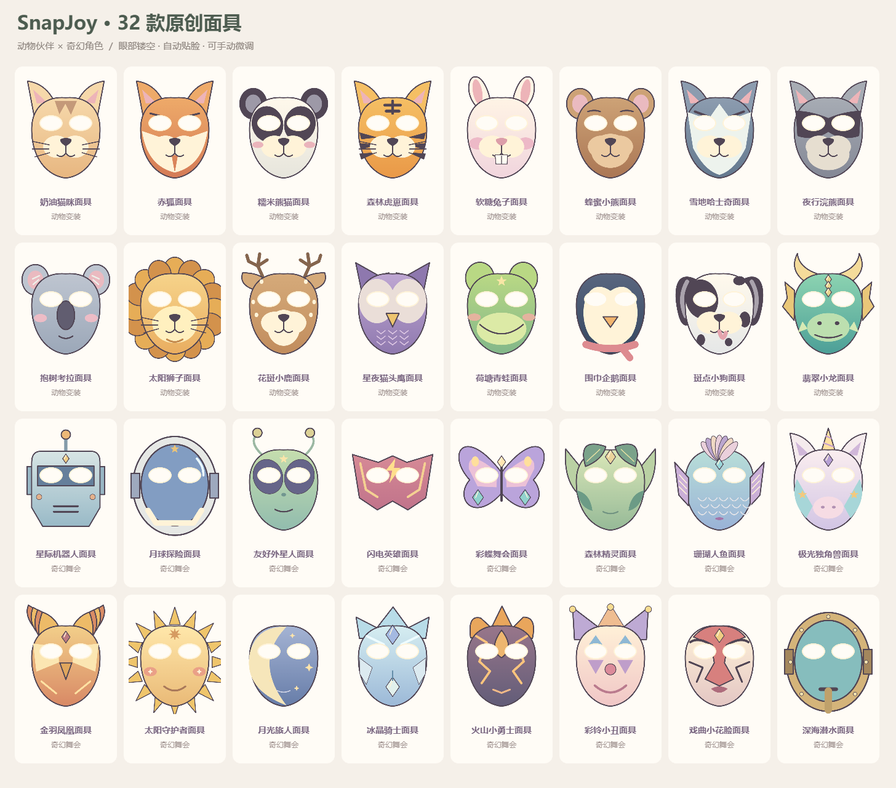

# SnapJoy · 拾光相机

一个适用于 Windows 和 macOS 的本地趣味拍照与录像软件，参考 Photo Booth 的实时特效与拍照体验，采用独立设计的中文界面。

当前版本 **1.4.0**，增加 24 种实时特效、32 款眼部镂空面具和 16 套主题造型，支持 Windows 与两种芯片的 Mac。SnapJoy 表达“拍下快乐”，提供实时特效、趣味装扮和主题相框，适合自己拍照、亲子互动和朋友聚会。

项目仓库：[ShellLayer/snapjoy](https://github.com/ShellLayer/snapjoy)。仓库包含源码、锁定的依赖版本、本地人脸定位模型和验证资料。版本变化见 [CHANGELOG.md](CHANGELOG.md)。



改版依据见 [趣味相机调研与改版](docs/1.3.0/产品调研与改版.md)，发布检查结果见 [1.3.0 验证记录](docs/1.3.0/验证记录.md)。

## 打开与拍照

[下载 1.4.0 安装包](https://github.com/ShellLayer/snapjoy/releases/tag/v1.4.0)，选择与你的电脑对应的文件。新版本只在三个平台的检查通过后发布：

| 电脑 | 下载文件 | 安装方式 |
| --- | --- | --- |
| Windows 10 或更新版本，64 位，推荐安装版 | `SnapJoy-1.4.0-Windows-Setup.exe` | 按向导安装，可选择目录 |
| Windows 64 位，便携版 | `SnapJoy-1.4.0-Windows.exe` | 双击运行，无需安装 |
| Mac，Apple 芯片，macOS 13 或更新版本 | `SnapJoy-1.4.0-macOS-arm64.dmg` | 打开后拖入「应用程序」 |
| Mac，Intel，macOS 13 或更新版本 | `SnapJoy-1.4.0-macOS-x64.dmg` | 打开后拖入「应用程序」 |

Mac 可在苹果菜单 → 关于本机查看芯片和系统版本。ZIP 为对应 Mac 应用的备用压缩包。

Mac 版采用临时签名，尚未完成 Apple Developer ID 签名与公证。首次打开可能需要按照 [Apple 官方说明](https://support.apple.com/zh-cn/102445)，在系统设置 → 隐私与安全性中为本应用选择「仍要打开」。详细安装说明见 [1.4.0 发布说明](docs/releases/1.4.0.md)。

本地 Windows 版可使用根目录的 **拾光相机** 快捷方式，或打开 `release/1.4.0/win-unpacked/拾光相机.exe`；文件夹版需要保留同目录内的全部文件。旧版发布文件保留供回退，新版沿用原来的相册和设置。

GitHub 仓库提供源码，安装包、电脑快捷方式和测试临时文件不加入版本控制。从仓库下载后，请按下文“开发”步骤运行或打包。

1. 点击「开启摄像头」。可使用电脑内置摄像头或 USB 摄像头。
2. 在右侧「特效 / 贴纸 / 相框」里搭配造型，也可以点骰子随机搭配。
3. 在顶部选择画幅和保存尺寸；选择单张、四连拍或录像。照片支持即拍、3 秒、5 秒或 10 秒倒计时。
4. 点击圆形拍摄按钮或按空格键。录像时再次点击停止并保存，可暂停／继续，声音默认关闭。按 F 切换大取景。
5. 点击底部缩略图或「我的相册」查看照片或播放视频，支持另存为和移到回收站。

原图自动保存到当前用户的 **图片 / 拾光相机** 文件夹。会使用系统实际指定的图片目录，在软件内点击「作品文件夹」可直接找到。Mac 关闭窗口后可从 Dock 再次打开；要完全退出可按 Cmd+Q。

## 功能

- **84 种效果（含原片）**：新增彩纸、雪花、泡泡、萤火虫、飘落樱花等动态效果，水墨、蓝晒、彩铅、丝网、拼豆、毛线等画风，以及水球、波纹、扇形分身、百叶魔镜等变形。
- **152 款原创矢量脸部装饰**：保留 120 款配饰，新增独立的「面具」分类，含 16 款动物面具和 16 款奇幻角色面具。主列表不使用系统表情符号；旧造型中的表情仍能读取。
- **24 款相框、40 套一键造型**：新增猫咪茶话会、赤狐森林、龙岛探险、珊瑚泡泡、银河机器人、彩蝶舞会等造型；所有造型都能拍照或录像。
- **大取景模式**：按 F 或点击顶部按钮，收起侧栏和胶卷条。
- **5 种画幅与可选尺寸**：16:9、4:3、1:1、3:4、9:16；原生或长边 640 / 1280 / 1920 / 3840。居中裁切，不拉伸或放大小画面。3840 选项会请求摄像头更高分辨率，实际输出仍取决于设备支持。
- **录像**：最多 10 分钟，最高长边 1920；尺寸按画幅适配，例如方形最高 1440 × 1440，界面显示实际保存尺寸。支持暂停／继续和可选声音；优先 H.264 MP4，不支持时使用 VP8 WebM。隐藏窗口时自动暂停。声音只有主动勾选才启用，停止后释放麦克风。
- 镜像、特效、贴纸和相框会进入最终作品；构图网格和选中虚线不会保存。
- 四连拍生成纵向照片条，单格最高长边 1920；后续每张至少有 1 秒准备时间。
- 照片保存为 PNG；视频、缩略图和相册索引均位于本地，重启保留作品和造型。
- 录像按秒写入暂存文件，保存失败可在当前窗口重试；未保存前关闭会提示。强制关闭或断电仍可能中断作品，不保证损坏的暂存视频可恢复。
- 无 WebGL 时自动启用兼容模式，可用 27 种基础效果、全部配饰、面具和相框；兼容滤镜外观与完整模式可能不同。

「热力感应」是艺术配色，不是测温功能。变形效果作用于画面，不进行身体测量。软件不提供背景抠图。

## 小朋友的变装玩法

- 在「贴纸」中点击一款即可添加，最多同时叠加 20 张，可以重复添加同一款。
- 在「贴纸·面具 → 面具」选择动物或奇幻角色。面具默认按双眼位置和倾斜角度贴合，眼部透明；换款自动替换已有面具、保留其他配饰，可撤销。需要叠放时可使用「复制」。面具是二维装饰，嘴部图案不会随张嘴变化。
- 变装贴纸默认勾选「跟随人脸」。本地模型会定位主要一张脸，让头饰、眼镜等随位置、大小和倾斜变化；不识别是谁。未找到脸时贴纸暂时固定，光线不足、侧脸或遮挡时可切换手动。
- 首次使用自动跟随时，需要稍等本地模型准备，期间仍可拍照或手动摆放贴纸。如果提示准备失败，可关闭摄像头再开启，重新尝试。
- 直接拖动贴纸会切换成手动摆放。点击画面里的贴纸选中，可在右侧选择推荐、头顶、额头、双眼、左右眼、鼻子、嘴、双颊、左右脸颊、下巴、整脸或脖子，并调整上下／左右偏移、大小、旋转、复制、置顶或移除；勾选「跟随人脸」可恢复跟随。
- 头部离画面上沿太近时，耳朵或帽子可能被裁切，稍微后坐或把脸移到画面中间即可。强烈变形滤镜可能影响贴合，适合关闭跟随后手动调整。
- 「撤销」或 Ctrl+Z（Mac 为 Cmd+Z）撤销装饰操作；Delete 移除选中的贴纸；「清空贴纸」只清空贴纸；搜索栏旁的「重置」清空造型并恢复原片。
- 骰子按钮会随机搭配一套造型。仍可继续换滤镜、加贴纸和选相框。
- 贴纸、相框和摆放设置会在重启后保留。贴纸选中时的虚线框只用于编辑，不会保存进照片。

## 数据与摄像头

软件不需要账号，不上传画面、照片或使用记录，仅在勾选「录制声音」并开始录像时请求麦克风，停止后立即释放。人脸定位模型随程序打包，在本机后台线程运行，不需要下载模型或联网；不存储身份或人脸模板。没有启用跟随贴纸时不做人脸定位。开启相机后，最小化时摄像头仍保持连接；点击关闭摄像头或关闭软件可停止。

应用本身不进行云同步。如果图片目录已由 OneDrive、iCloud 或其他软件同步，照片仍会遵循用户现有的文件夹同步设置。

照片文件夹内的 `.library.json` 记录相册索引，`.thumbnails` 存放缩略图；备份时建议复制整个「拾光相机」文件夹。请不要单独删除索引文件。删除照片会把原图移到 Windows 回收站或 Mac 废纸篓；恢复后仍可以在文件夹中查看原图，软件不自动重新加入相册。`.recordings` 为录像暂存目录，备份时一并保留。

## 摄像头打不开

- 未发现设备：连接 USB 摄像头，或确认电脑自带摄像头未被禁用、物理遮挡开关已打开。
- Windows 权限不足：点击软件提示中的「打开 Windows 摄像头设置」，允许桌面应用访问摄像头。
- Mac 权限不足：点击「打开 Mac 摄像头设置」，在系统设置 → 隐私与安全性 → 摄像头中允许「拾光相机」，然后退出并重新打开软件。
- 设备被占用：退出正在使用相机的会议或拍照软件，然后重试。
- 多个摄像头：使用取景器下方的下拉框选择。
- 相机意外断开：重新连接后点击「重试摄像头」。

## 开发

需要 Windows x64 或 macOS 13+、Node.js 22 或更新版本，以及 Git。首次安装开发依赖需要联网，应用运行时不需要联网。DMG 在 macOS 上构建，Windows 安装包在 Windows 上构建。

使用 Electron 45.2.3、原生 JavaScript、WebGL、Canvas 和 MediaPipe Tasks Vision 1.2.2。本地人脸定位使用 BlazeFace short-range float16 v1；SDK、WASM、模型及第三方声明位于 `src/vendor/mediapipe`，已随应用打包。

```powershell
git clone https://github.com/ShellLayer/snapjoy.git
cd snapjoy
npm ci
npx install-electron
npm run sync-vendor
npm start
npm test
```

Windows 使用 `npm run pack -- --publish never` 生成本地文件夹版；安装包使用 `npm run dist -- --publish never`。Mac 使用 `npm run dist:mac -- --arm64`（Apple 芯片）或 `npm run dist:mac -- --x64`（Intel）。打包输出在 `release/1.4.0`。GitHub 构建流程会读取项目版本，将对应平台的检查记录和安装包归档；三个平台均通过后发布预览版。

GitHub 的 `Build desktop packages` 工作流在 Apple 芯片 Mac 原生环境、Mac Rosetta 的 Intel 运行环境及 Windows 上运行完整测试、构建并启动发布程序。全部通过后才上传下载包。Intel 包为 x86_64 程序，本轮图形验证通过 Rosetta 完成，真实 Intel Mac 硬件仍待实拍验证。手动触发时可关闭 `publish`，只构建和验证；正式触发时的发布内容为预览版，Apple 开发者证书与公证尚未接入。后续接入证书时，应更新 Mac 签名配置并启用 hardened runtime 与公证，凭证通过 GitHub Secrets 提供。

兼容性约定：`studio.lumi.booth` 应用标识、`lumi://app/` 本地协议、`lumi:` 存储键和中文应用名继续保留，用于沿用已有照片与设置；对外英文名称统一为 SnapJoy。

开发时下载 Electron 如需使用已有网络代理，可在当前终端设置 `$env:ELECTRON_GET_USE_PROXY = '1'` 后重试。应用运行时无需该设置。

测试使用模拟摄像头与麦克风、公开的 MediaPipe 测试图片和独立临时相册，不访问真实摄像头与麦克风、不触碰用户照片。测试涵盖全部效果、贴纸、相框的不同输出，镜像、人脸定位、拖动与调整、PNG 与预览逐字节一致、四连拍合成、取消、防重复拍摄、相册与造型持久化、删除、另存为、权限与断连、保存失败重试，以及无 WebGL 的兼容模式。此外检查五种画幅、不同尺寸、跟随位置偏移、视频暂停／回放／定位／导出／删除、音频按需授权与释放，以及录像保存重试。测试图片不包含在发布程序中。

实现参考：[Electron 安全指南](https://www.electronjs.org/docs/latest/tutorial/security)、[媒体权限接口](https://www.electronjs.org/docs/latest/api/session)、[自定义本地协议](https://www.electronjs.org/docs/latest/api/protocol)、[Windows 打包配置](https://www.electron.build/docs/configuration/)、[Playwright Electron 测试](https://playwright.dev/docs/api/class-electron)。

Mac 参考：[Electron 摄像头授权](https://www.electronjs.org/docs/latest/api/system-preferences#systempreferencesaskformediaaccessmediatype-macos)、[electron-builder 26 Mac 配置](https://www.electron.build/v26/docs/mac/)、[Electron 45 支持平台](https://github.com/electron/electron/blob/v45.2.3/README.md#platform-support)。

人脸定位参考：[MediaPipe Face Detector 官方文档](https://developers.google.com/edge/mediapipe/solutions/vision/face_detector)。详见 `src/vendor/mediapipe/SOURCES.md` 中的版本、模型来源和校验值。
