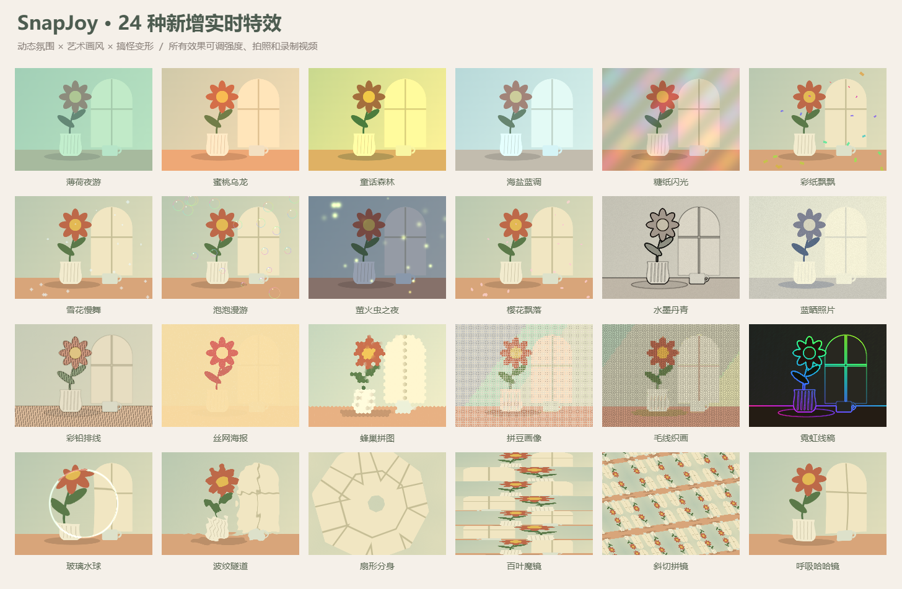

# SnapJoy · 拾光相机

把电脑摄像头变成趣味照相馆。加点特效、戴上面具，拍张照片或录一段视频，适合亲子互动和朋友聚会。

## 下载

当前版本 **1.4.0 预览版**，支持 Windows 和 macOS。

| 你的电脑 | 下载 |
| --- | --- |
| Windows 10 / 11，64 位 | [下载安装版](https://github.com/ShellLayer/snapjoy/releases/download/v1.4.0/SnapJoy-1.4.0-Windows-Setup.exe) |
| Mac · Apple 芯片（M 系列），macOS 13+ | [下载 Mac 版](https://github.com/ShellLayer/snapjoy/releases/download/v1.4.0/SnapJoy-1.4.0-macOS-arm64.dmg) |
| Mac · Intel 芯片，macOS 13+ | [下载 Mac 版](https://github.com/ShellLayer/snapjoy/releases/download/v1.4.0/SnapJoy-1.4.0-macOS-x64.dmg) |

[Windows 免安装版](https://github.com/ShellLayer/snapjoy/releases/download/v1.4.0/SnapJoy-1.4.0-Windows.exe) · [全部下载与更新说明](https://github.com/ShellLayer/snapjoy/releases/tag/v1.4.0)

Windows 按向导安装，Mac 打开 DMG 后拖入「应用程序」。首次打开如遇系统提示，请看[安装帮助](docs/使用指南.md#安装与首次打开)。

## 可以怎么玩

- **84 种实时效果**：复古胶片、水墨、彩纸、飘雪、泡泡，还有搞怪变形。
- **152 款脸部装饰**：包含 32 款动物与奇幻面具，支持自动跟随人脸，也能手动调整。
- **40 套一键造型、24 款相框**：选好搭配就能拍，点击骰子还能随机换装。
- **拍照与录像**：单张、四连拍、带特效的视频；支持大取景、5 种画幅、照片尺寸调整，以及录像暂停与继续。

看看面具和特效

## 三步开拍

1. 打开软件，点击「开启摄像头」。
2. 选择特效、贴纸或面具，再选画幅和拍摄模式。
3. 点击拍摄按钮或按空格键；录像时再次点击即可停止保存。需要声音时，先勾选「录制声音」。

作品保存在 **图片 / 拾光相机**，点击软件里的「作品文件夹」即可找到。按 **F** 可切换大取景。

无需账号，画面处理和作品保存都在本机，应用不上传照片或视频。若图片目录已由 OneDrive、iCloud 等同步，会沿用你的文件夹同步设置。

[使用指南与常见问题](docs/使用指南.md) · [开发指南](docs/开发指南.md) · [更新记录](CHANGELOG.md)
